# Cluster Themes

Redraws the whole instrument cluster in a theme of your choice. Open **Cluster Themes** from the apps menu on the center screen: its own page has seven tabs along the top: Theme, Gauges, Model name, Waze map, Warnings & shift lights, G-meter and Settings. Every button says what it does, with a short grey line under it where the name alone isn't enough.

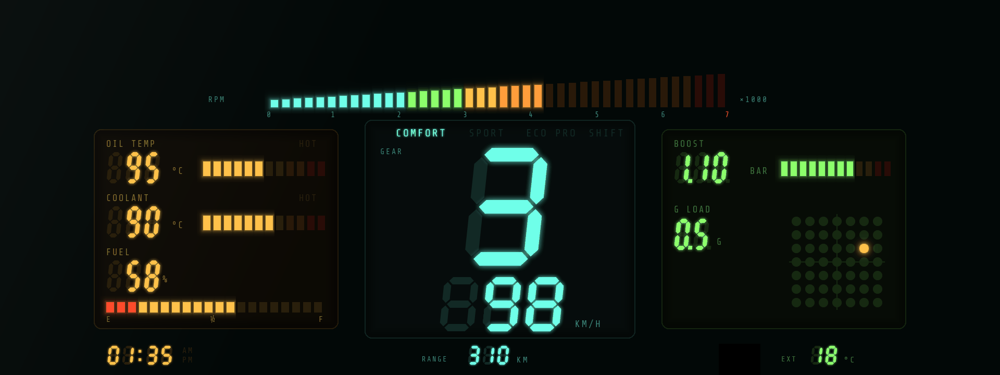

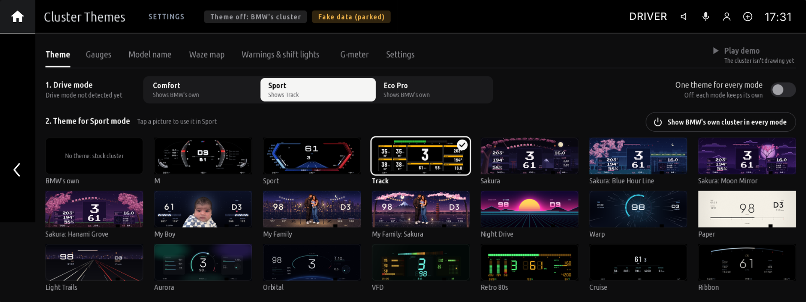

## Themes

Every theme fills the cluster and shows its own clock, range and outside temperature along the bottom, in the theme's style. Only BMW's gear letter at the bottom right stays uncovered: when a theme covers it, BMW draws a black box over the theme (issue #5). Every theme shows the drive mode (Comfort, Sport and so on) next to the gear.

### M

A current M8's cluster, traced off a photo of it and drawn on black.

- **Middle:** two bowed glass rev blades either side of the gear and speed, reading 0 to 7000 rpm like the M40i's own cluster. A red marker rides each blade at the rpm, the blade glows below it, and orange and red marks sit before and past your redline. The gear shows with its shifter programme: P, D3, S3 or M3, and the drive mode sits under the speed.
- **Left:** a black card with a grey rim and four readouts where the M8 has its tyre block: boost, coolant, oil and intake air out of the box, each one changeable on the Gauges tab. The fuel dial sits over the card's lower corner, drawn like the M8's: a thin glass bracket inside a hatched chrome bezel, lit from the bottom up to the level, with a thin red line at the level.
- **Right:** what the engine, chassis, steering and gearbox are set to, as four rows with a step bar, and the oil temperature dial, the same glass bracket. The rows follow the drive mode buttons: Eco Pro, Comfort, Sport, Sport Plus and Sport Individual. The car only reports that an Individual setup is on, not what each part is set to, so those rows read INDIVIDUAL.
- **Bottom:** the clock, range and outside temperature, with BMW's own gear letter.
- **With the Waze map:** the blades keep their shape and numbers and move out to the sides, the map fills the middle between them, and the gear, speed and drive mode sit in a row under it.

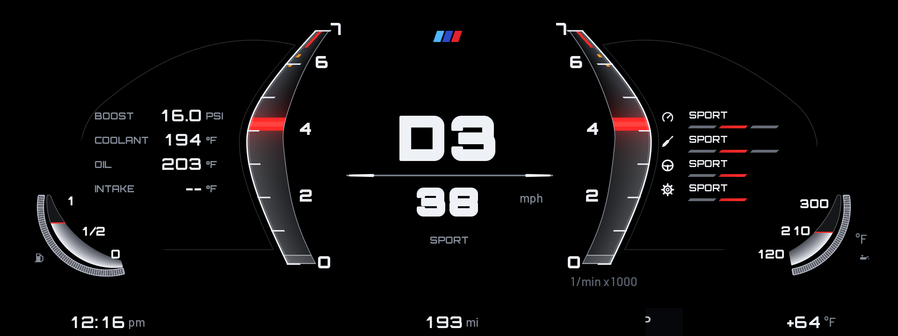

### Sport

The look of BMW's newer Live Cockpit Sport view.

- **Left:** speed as a blue bracket on BMW's 0 to 200 mph scale (0 to 320 km/h), with a fuel bar up its lower leg.
- **Right:** revs as a red bracket on the M40i's 0 to 7000 rpm scale, with yellow and red marks around your redline, with an oil temperature bar up its lower leg.
- **Middle:** the speed in big figures with the gear and drive mode under it, over a road like BMW's own Sport view whose lane dashes run towards you as you drive. With "Show Waze map inside the theme" on, the map takes the middle and the speed and gear move into the brackets.
- **Bottom:** boost and coolant in the blue and red bar. Under it, the clock, range and outside temperature, with BMW's own gear letter.

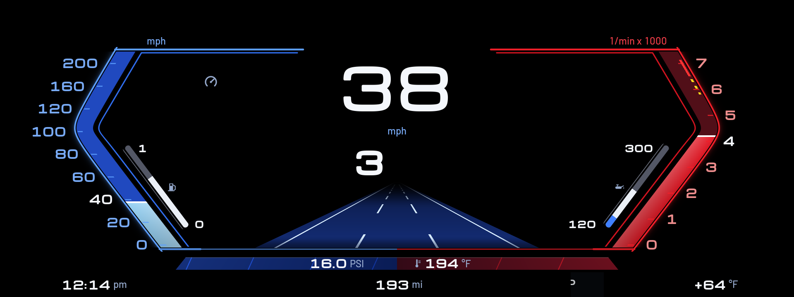

### Track

A race dash for track days (it took over from GT3 in 0.21.0, as the theme out of the box and in Sport): a shift bar across the top, a big gear with the speed under it, all four tyres (pressure and temperature, from the car's tyre monitor) on the left, oil, coolant and boost on the right (changeable), and fuel.

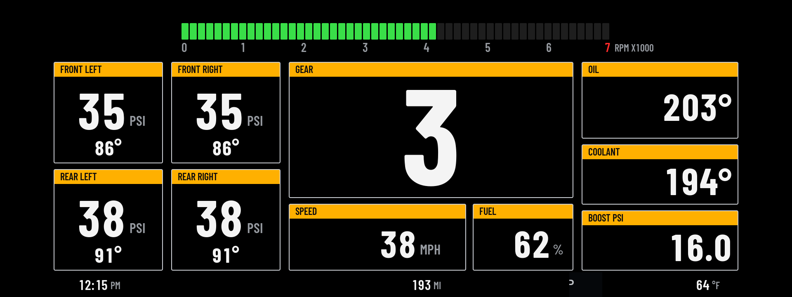

### Sakura

Pixel art at night: a cherry tree arching over the top of the cluster, Mt. Fuji, a torii in the lake, lanterns and a full moon, with petals drifting down (a little faster the faster you drive). The revs are 14 blossoms along the branch, one per 500 rpm: each opens as the revs reach it and blooms when they pass it, pink, then white, then red, and every lit blossom flashes at the shift point while the middle frame turns red and SHIFT 変速 blinks over the gear. A huge gear and speed in the middle, oil, coolant and fuel on the left, boost and a pixel G-meter on the right, each with its Japanese label, and the clock, range and outside temperature along the bottom. Oil, coolant or boost over its warning limit turns its plate amber with dark text, 高温 and a blinking ! block. The whole scene, petals, blossoms and plates are one shader reading a 9 KB picture; the text is Press Start 2P, Silkscreen and DotGothic16. Not yet tested on a car.

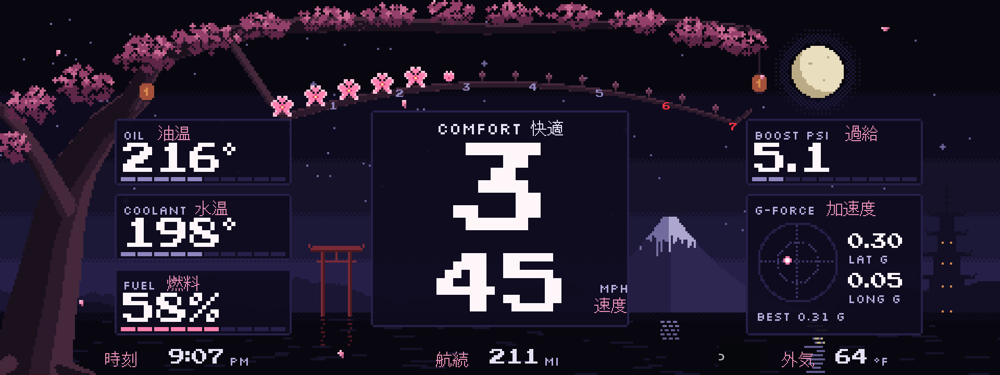

Three more Sakura scenes share a slimmer layout: wide plates with the value on the right and the labels stacked on the left, the boost and G plates on the right, and the revs as a 28-segment bar over the middle (pink, white from 5,000 rpm, red from 6,000; every lit segment flashes white and red at the shift point), or the blossoms on the twig in Hanami Grove. Pick them on the Theme tab as **Sakura: Blue Hour Line** (an elevated train line at dusk, a tree and a railing), **Sakura: Moon Mirror** (a lone tree before a huge moon, its petals blowing left with the wind) and **Sakura: Hanami Grove** (two trees, fallen petals on the grass). Not yet tested on a car.

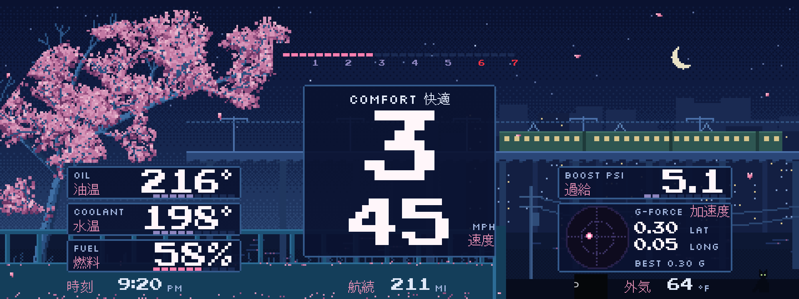

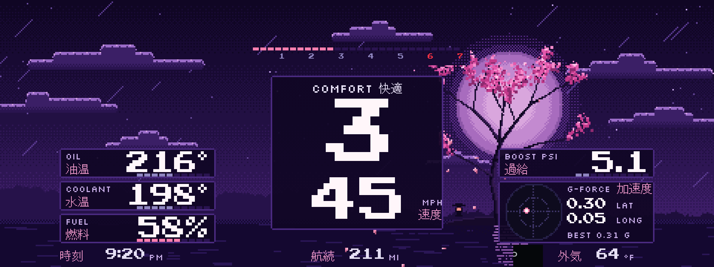

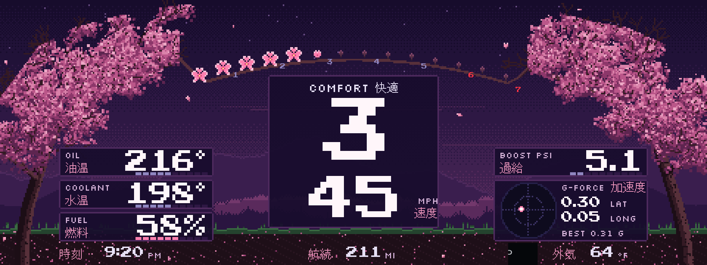

### My Boy

A photo of a little one in the middle of the cluster, on a night-blue sky with faint twinkling stars and a soft glow behind his head. The photo is cut out and drawn pixel for pixel, with his face on the cluster's centre line and his head clear of the driver camera on newer cars.

- **Left:** the drive mode, the speed and its unit.
- **Right:** the gear, with a small heart under it that slowly breathes while the car stands still.
- **Revs:** two strips of checks in his romper's blue and cream, one under each side, filling from the outer ends towards him. They turn red at your redline, and every lit square flashes red at the shift point.
- **Under them:** oil and coolant on the left, fuel and range on the right.
- **Bottom:** the clock on the left and the outside temperature on the right, with BMW's own gear letter.

To make one from your own photo: `tools/bake_photo_art.py prep` cuts it out (it needs a cut-out on black, as a phone's "lift subject" gives), then `tools/bake_photo_art.py` bakes it and `tools/gen_myboy.py` lays it out.

### My Family

The family in the middle of the cluster, standing on a cobbled canal quay at blue hour, in pixel art: a row of gabled canal houses (step, neck, bell and spout gables and a church tower) with lit windows, a few going on and off, their reflections wobbling in the water, stars and a crescent moon, bikes and red bollards on the quay, and two old street lamps either side of the family.

- **Revs:** two strings of fairy lights across the top, lit from their outer ends towards the family: warm white, then amber, then red from your redline. At the shift point every bulb turns red and pulses.
- **The water** ripples faster the faster you drive.
- **Readouts** as My Boy's: the drive mode and the speed on the left, the gear on the right, oil and coolant, fuel and range along the quay, the clock and the outside temperature at the bottom.

The family is one picture (`tools/photo-src/family.png`, baked by `tools/bake_photo_art.py`, laid out by `tools/gen_family.py`); everything else is drawn by the GPU. Not yet tested on a car.

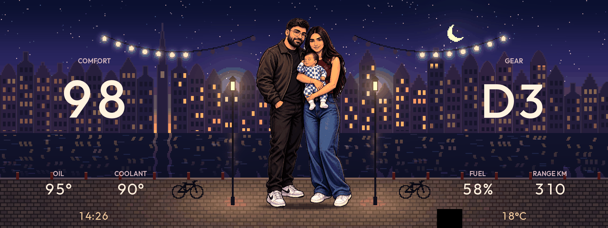

### My Family: Sakura

The family under cherry blossom by a lake at night, painted smooth to match their picture: a full moon, Mount Fuji with its snow in the moonlight, the far shore's trees and festival lights, a red five-storey pagoda, all mirrored in the lake with the moon's path glittering on it, cherry trees at both sides arching over the top in blossom, two stone lanterns alight beside the family on a stone bank strewn with fallen petals, and petals falling all the time.

- **Revs:** paper lanterns hung from the branches in two strings, lit from their outer ends towards the family: warm, then red from your redline. At the shift point every lantern turns red and flashes.
- **The wind** blows the petals harder and the lake ripples faster the faster you drive; parked, they drift down gently.
- **Readouts** as My Family's.

The same picture of the family as My Family; everything else is drawn by the GPU (`scene_hanami` in `shared/shaders.js`, laid out by `tools/gen_family.py`). Not yet tested on a car.

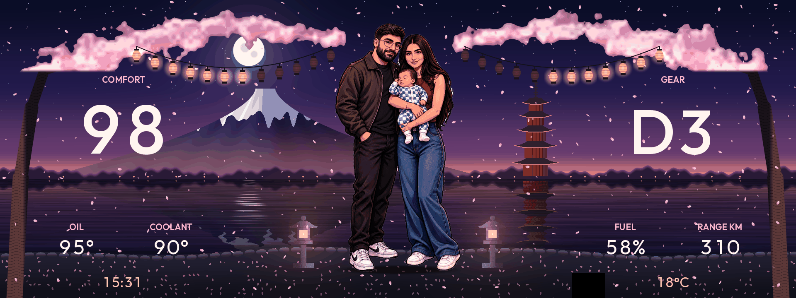

### Retro 80s

An 80s digital dash: amber seven-segment digits with their unlit 8s showing faintly behind, for the gear and the speed. A segmented rev bar runs across the top, bar graphs show oil, water and fuel on the left, and boost and two readouts sit on the right. The clock, range and outside temperature along the bottom are seven-segment digits too.

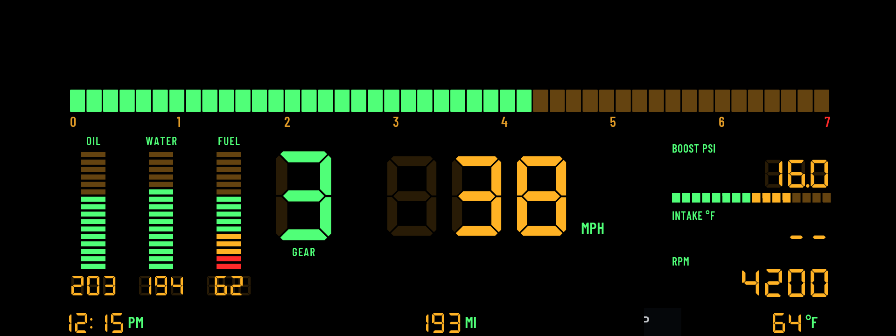

### Cruise

Calm and quiet for the highway: the speed in soft white, the gear beside it, and one row of figures (fuel, oil, coolant, rpm and your average speed this drive). No rev bar, and nothing red until the fuel runs low. The average speed counts only time moving and shows after the first minute of the drive.

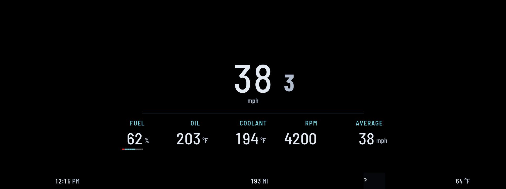

### Ribbon

Calm and premium. One ribbon of light runs along under the top edge of the cluster and fills with the revs, cool white warming to amber, then red near the redline, with a dot and a number at every thousand (the last two in red). The speed sits in the middle in big thin numbers with the gear in a small frame above it. Oil, coolant and boost are on the left, and fuel and your average speed this drive on the right.

**Holiday editions:** Christmas (the ribbon becomes a string of coloured bulbs that light up with the revs, with falling snow), Thanksgiving (falling maple leaves), New Year (bubbles and gold confetti) and the Fourth of July (fireworks), each with its own colours and a greeting under the speed. The decorations stay clear of the numbers. Set by **Holiday editions** in Settings.

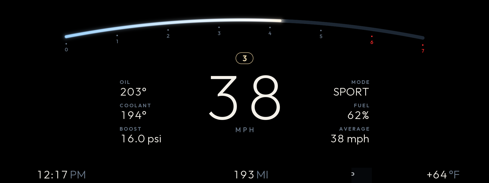

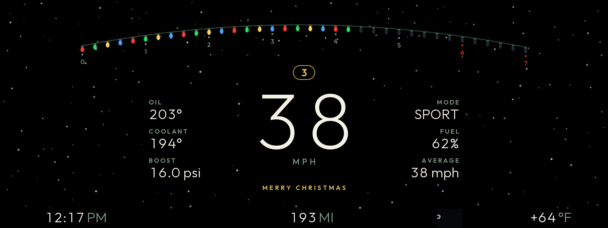

### Night Drive

Synthwave: a purple night sky over a neon grid that runs towards you as you drive, a striped sun whose glow pulses with the revs, and mountains at the sides. The revs light the horizon line from the middle out. The speed sits left of the sun and the gear right of it, in chrome figures, with the clock and outside temperature above them.

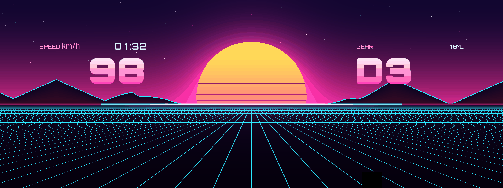

### Warp

Stars stream out of the middle: dots when you go slowly, long streaks when you go fast. The revs are a ring round the speed in the middle, and the whole sky flashes at the shift point. The clock and outside temperature are on the left, the gear and drive mode on the right.

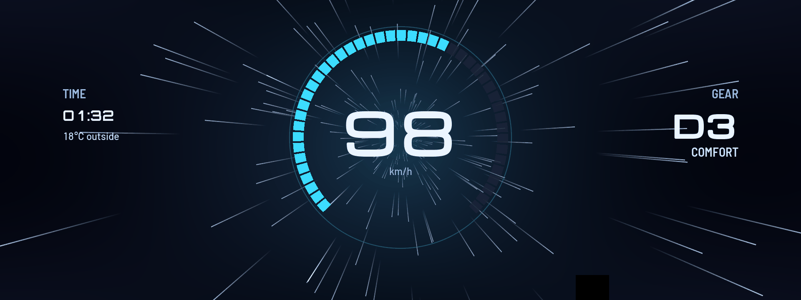

### Paper

Ink on warm paper, like an e-ink page. The speed is big in the middle; under it one hairline with a tick at every thousand rpm is inked thick up to the revs, in red from your redline, and all red at the shift point. The clock and outside temperature are on the left, the gear and range on the right, the drive mode at the foot of the page. Nothing else moves.

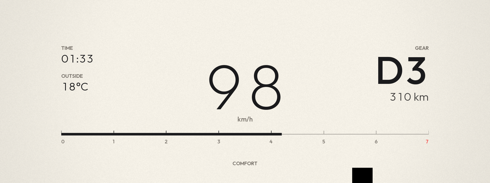

### Light Trails

A long-exposure photo of a highway at night: white headlight trails coming, red tail lights going, all running to a city glowing on the horizon, with street lamps and lane dashes rushing by. The streaks get longer and brighter the faster you go, and the revs are a white-to-red light streak along the top.

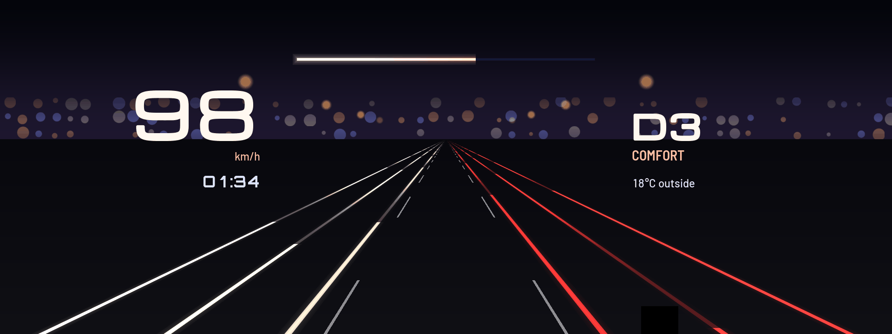

### Aurora

Modern EV glass: aurora light drifting behind two frosted glass cards, and a glowing ring gauge round the gear and speed, lit mint to violet up to the revs with a red zone, orange and pulsing at the shift point. The left card has oil, coolant and fuel with their bars, the right one boost and a G-force ball. A "Shift up" pill shows at the shift point, and a warning pill when the coolant is over its limit.

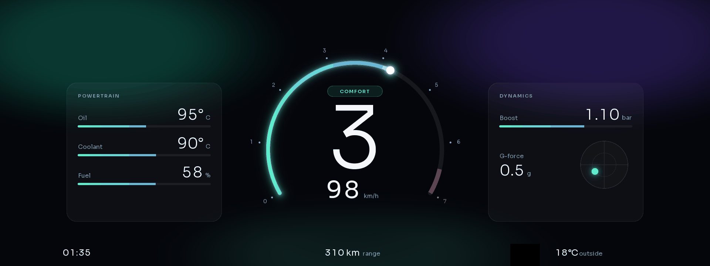

### Orbital

Space telemetry: a star field over a planet's horizon, and the revs as a satellite going round an orbit about the gear, lit cyan up to the revs and red from 6,500 rpm, orange and blinking at the shift point. The speed and the oil, coolant and fuel readouts are on the left, boost and an attitude globe with the G dot on the right, and a COOLANT ANOMALY tag shows over the limit.

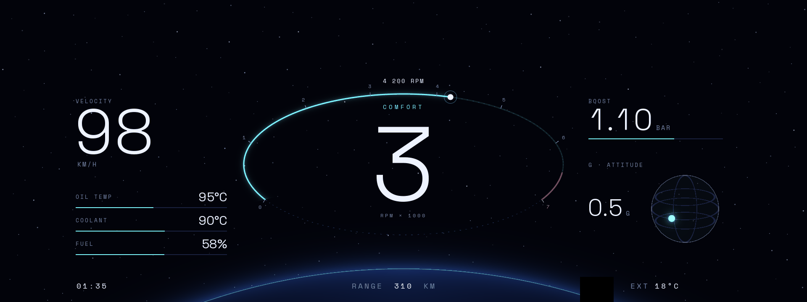

### VFD

An 80s vacuum-fluorescent dash in three colours at once, like the multi-colour dashes of the time: the gear and speed in cyan in the middle, oil, coolant, fuel and the clock in amber on the left, boost, the G load and the outside temperature in green on the right. Every number is in seven segments with the unlit 8s glowing faintly behind it. The revs are a skyline of 40 bars rising to the right, cyan, then green, amber, orange from half way and red from the redline, with the unlit bars a faint tint of their colour; at the shift point the whole skyline flashes red and orange and SHIFT blinks. Segment bars show oil and coolant (red at the hot end), fuel (red at the bottom) and boost, and a 7 x 7 dot grid lights the dot for the G load you feel (green, amber from 0.45 g, red from 0.85 g). The drive modes light in their own colours, and a temperature over its limit turns red and blinks with HOT.

Night Drive, Warp, Paper and Light Trails are drawn without pictures, as one shader each; Aurora, Orbital and VFD are built from designs on the app's design canvas. None of the seven is tested on a car yet.

Only Sport and M have a map window; with "Show Waze map inside the theme" on, Waze stays in its usual place while the others show.

More themes are on the way.

## Off and drive modes

- **Off (BMW's own cluster):** pick it as the theme and the app draws nothing, so BMW's cluster comes back. **Show BMW's own cluster in every mode** (Theme tab) does that for every drive mode in one tap, with Undo for 10 seconds.
- **A theme for each drive mode** (on by default): the cluster follows the drive mode buttons. On the Theme tab, pick the mode (1. Drive mode), then tap its theme (2.). Out of the box, Sport shows Track, and Comfort and Eco Pro show BMW's own cluster. **One theme for every mode** turns this off (it is **Change with SPORT / COMFORT / ECO PRO** in the kit's own All settings list). Until the car reports a mode, the cluster shows the **Default** theme (the fourth choice on the Theme tab); the page starts on whichever is in use now, so a tap on a picture changes what the cluster shows.
- **Plug-in hybrids:** the car sends its mode as PHEV_SPORT_STANDARD and so on; recognised since 0.22.2.
- **M cars:** the Efficient, Sport and Sport+ modes of M cars are not recognised yet, so the theme doesn't change with them. **Settings, Details for bug reports** shows the value your car sends; please post it in an issue so it can be added.
- **With HUD Widgets:** on cluster-render 0.5.1 and newer, a cluster theme and a HUD layout show at the same time. On older cluster-render they share one screen slot and take turns: pick a theme while the HUD is on and the page asks whether to turn HUD Widgets off, and it asks the same the other way round.

## Settings

The names below are the page's. The kit's own **All settings** list (the SETTINGS button at the top) keeps the shorter names from app.json.

- **Theme:** one per drive mode, or **One theme for every mode**.
- **Gauges:** pick which car value each box of M, Track or Retro 80s shows (speed, rpm, boost, temperatures, tyres, fuel, g, power and more). Plug-in hybrids can also show **Hybrid battery**, the high-voltage battery's charge in % (not yet checked on a hybrid). **Put Track's boxes back** (or M's, or Retro 80s') puts that theme's boxes back as they came; it asks first.
- **Waze map, Show the Waze map in the theme:** Sport and M open a window in the middle and Waze on Cluster draws its map in it, above BMW's own map view, so nothing shows twice. When the map goes away the theme fills back in. While it is on, Waze's map on the HUD is off. Needs robertnisipeanu's Waze on Cluster; turning it off gives Waze its usual place back.
- **Model name:** your model, like "BMW X3 M40i", as text in the theme's font (Sport and M, where BMW puts its own): 1. the series, 2. your model, **Write "BMW" in front**, or **Show no model name** (the default).
- **Warnings:** **Oil is hotter than**, **Coolant is hotter than** and **Boost is higher than**. A readout over its limit flashes red (oil 130°C and coolant 115°C by default, boost off). **Put warnings back** returns all three to these, with Undo.
- **Test the shift lights** (Start test): runs the rpm up to the shift point for about 4 seconds while the car stands.
- **Play demo:** the button at the top of the page plays a 60-second show on the cluster while the car stands (a pull through the gears with graded shifts, the limiter, braking, corners, boost, the oil warning once), with a DEMO tag. It stops at the end, on Stop, or as soon as the car moves, and nothing from it is kept.
- **Shift lights, How they light up:** **Timed** (the default; Count in in the kit's list) fills the lights over about the last second before the shift point and flashes early by your reaction time; **Fixed** (Fixed rpm band) works as before. Ported from Redline (MIT).
- **Hide oil and coolant when they are normal** (off by default): oil and coolant turn blue while cold, yellow while warming, red over their limit; the outside temperature turns blue at 3°C (37°F) and under.
- **Dim after sunset:** after sunset the theme's whites and greys dim to 60% (Auto, the default), or Off.
- **Units:** mph, °F, psi or km/h, °C, bar.
- **Clock:** 12-hour or 24-hour.
- **Time zone:** the head unit's clock runs on UTC, so pick your zone once. Named zones (US Eastern, Central, Mountain, Pacific, Alaska, Hawaii, Arizona, Canada Atlantic, Mexico, UK / Ireland / Portugal, Central Europe, Eastern Europe) change for daylight saving by themselves; for anywhere else, pick your offset from UTC. Dim after sunset uses the same zone to work out sunset.
- **Fuel tank size:** the fuel gauge asks the engine unit for the level in %. Where the engine unit doesn't answer, it works it out from the litres the car reports and this size (65 L on an X3, 59 L on a 3 Series).
- **Redline:** where the red marks start on the rev scales (they always cover at least the last 500 rpm, and the yellow marks sit in the 700 rpm before them).
- **Shift lights peak:** how far below the redline the shift lights peak (300 rpm by default).
- **Shift earlier while the engine is cold:** until the oil reaches 80°C, the shift point starts at 4500 rpm and climbs as the oil warms up.
- **Show turbo boost.**
- **Keep the top centre clear** (off by default): for newer cars with a driver attention camera in the top middle of the cluster, where other cars show the model badge. The rev bars (Track, Retro 80s) become two mirrored wings either side of the camera that fill from the outer ends in towards it and meet at the shift point, Track's rpm numbers are left out, M's logo is hidden, and Ribbon's ribbon dips under the camera instead. The camera's spot is taken from where the badge sits on a car without one. Not yet tested on a car with a camera; please report how it lines up on yours.
- **Holiday decorations:** a string of glowing holiday lights along the top of every theme, and Ribbon's own holiday edition. Auto (the default) puts them on by the date: Thanksgiving in its week (Monday to Sunday), Christmas from December 1 to 26, New Year from December 27 to January 2, and the Fourth of July from July 1 to 5, then takes them off again. Or pick one holiday to keep it on, or Off. The date follows the Time zone setting.
- **G-meter** (its own tab): **Circle edge** (0.8, 1.0, 1.2, 1.5 or 2.0 g; 1.2 by default), **Tail behind the dot** (off, 1, 2 or 4 seconds), **Flip left and right** (if the dot goes the wrong way in a turn) and **Show braking at the top**, **Most g this drive** (left and right turns, speeding up, braking, highest) with **Clear this drive's best g**, and a live copy of the meter. The g comes from the car's own acceleration sensor: parked on level ground it reads 0.00, and a hill adds a little.
- **Fake data while parked:** fake driving data for trying it out parked. It switches back to the car's own data as soon as the car moves faster than 5 km/h.
- **Details for bug reports** (Settings, Help and reset): the drive mode signals and what the app is doing (layers, picture memory, why nothing is drawn).
- **Reset everything** (Settings, Help and reset): every setting and every gauge box back to how the app came. It asks first. Out of the box Sport shows Track; to see BMW's own cluster, use Show BMW's own cluster in every mode.
- **Calibration grid** (in the All settings list): a theme that draws lines every 50 px with labels, for checking on a photo where things land on the real screen. It also carries a few test marks used to measure cluster-render's limits on the car.
- **Map calibration** (in the All settings list): a theme that leaves BMW's whole map window open with a grid through it, for photographing exactly what shows through the map cut-out with a navigation map up.

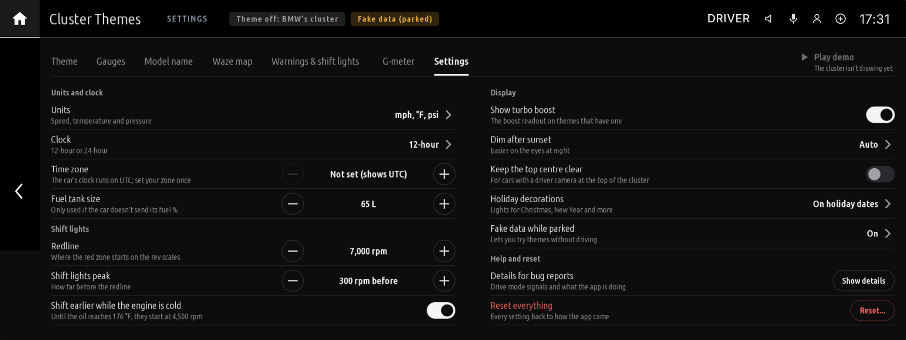

**Shift grades:** every upshift is graded on its peak rpm. EARLY means more than 250 rpm under the shift point, LATE more than 200 over it, COLD REV the same while the cold guard is on, LIMITER within 25 rpm of the redline, and anything in between is SPOT ON. Only shifts aimed at the shift point are graded: one more than 1500 rpm under it (an everyday shift) or one the gearbox made itself in D or S is left out, and the last grade stays on screen. When Redline 2.0.28 or newer is running, the shift point and the grade come from Redline, which learns a shift point for each gear.

## Requirements

[cluster-render](https://github.com/robertnisipeanu/idrive-apps), installed from the `robertnisipeanu/idrive-apps` Store source. Version 0.5.1 or newer lets the theme show together with HUD Widgets.

## On the car

Tested on a 2020 X3 M40i. Checked on the car: GT3 and Dyno (both retired in 0.21.0) drew complete, the Waze map shows inside Sport, and a theme and a HUD layout show together. Still to be checked:

- the other themes on the real screen, including M since its 0.10.0 rework;
- whether BMW's warning lights still show over the dash (start the car with a seat belt off and look);
- the clock with a named time zone, and the fuel % from the engine unit;
- the Hybrid battery readout on a plug-in hybrid;
- Play demo, the count-in shift lights and the switch-off guard (0.16.0).

If something looks wrong on your car, **Settings, Details for bug reports** says what the app is doing and why anything is not drawn. Please open an issue with it.

See [Use at your own risk](../../README.md#use-at-your-own-risk) before installing.

Version history is in the repo's [CHANGELOG.md](../../CHANGELOG.md).
